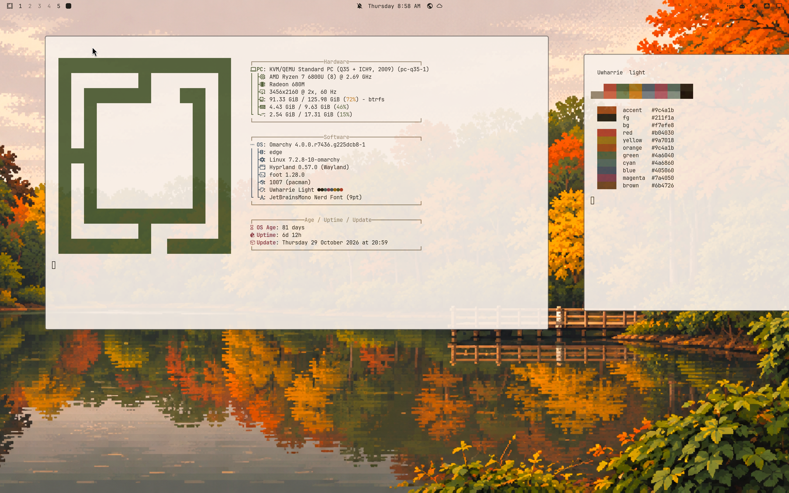

# Uwharrie Light

Pixel-art autumn lake for Omarchy. Warm orange and gold foliage over a still Piedmont shore, with a matching light palette.



## Install

```bash
omarchy-theme-install https://github.com/wesleygrimes/omarchy-uwharrie-light-theme
```

Or from the Omarchy menu: Install > Style > Theme, then paste that URL.

## Pair

Light is this repo. The other half is [Uwharrie](https://github.com/wesleygrimes/omarchy-uwharrie-theme).

## Backgrounds

Cycle with `Super + Ctrl + Space` or `omarchy theme bg next`.

| File | What it is |
| --- | --- |
| `1-uwharrie.png` | Still wallpaper (saturated light lift; nearest-neighbor only) |
| `2-uwharrie-animated.mp4` | Looping animated wallpaper (native Omarchy video background) |
| `3-uwharrie-animated.gif` | Original GIF, also listed as a background |

A milder washed still exists for comparison next to this repo on the build box. Swap `1-uwharrie.png` if you prefer it.

Omarchy 4.5 plays mp4/webm wallpapers through OWE. The GIF is included for tools that prefer it, and as the source of the mp4.

## Credits

Wallpaper: source unknown. Replace this line before publishing.

## License

MIT
